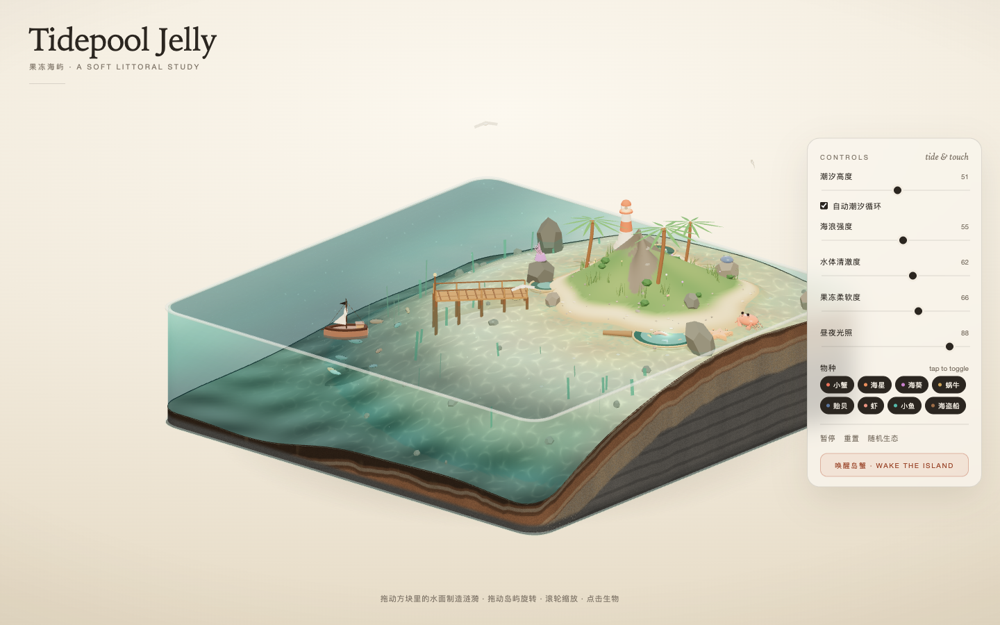
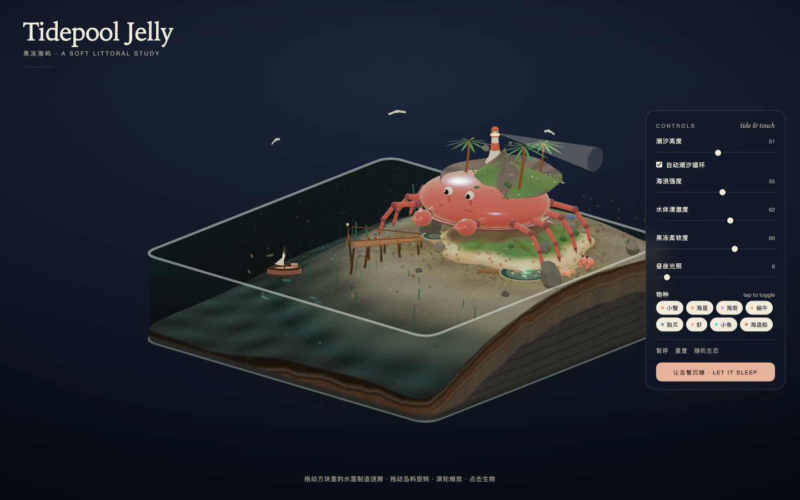
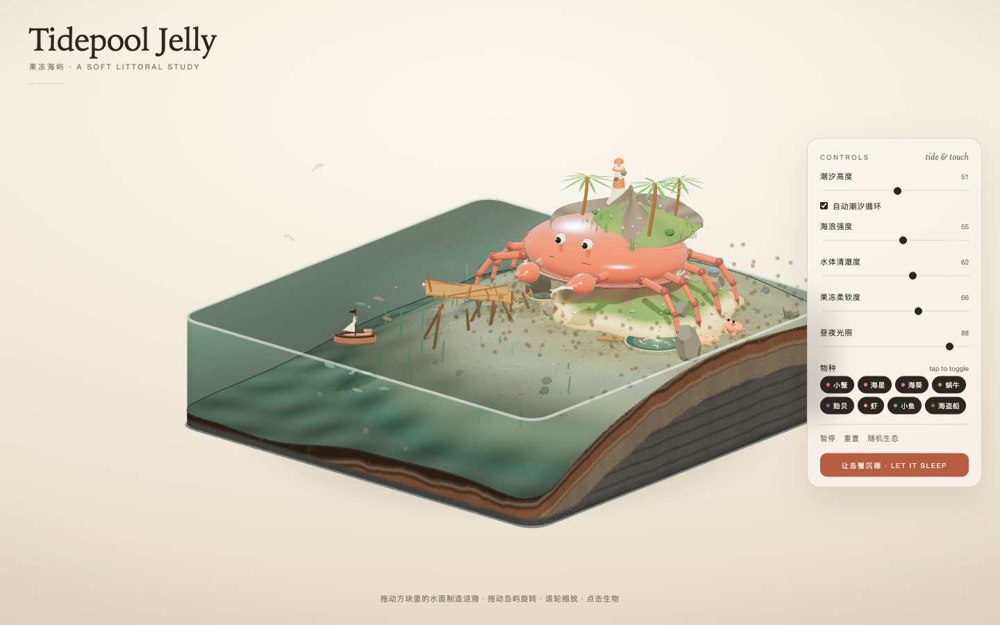
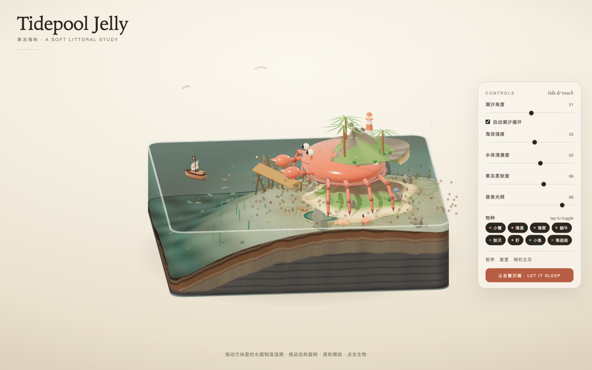
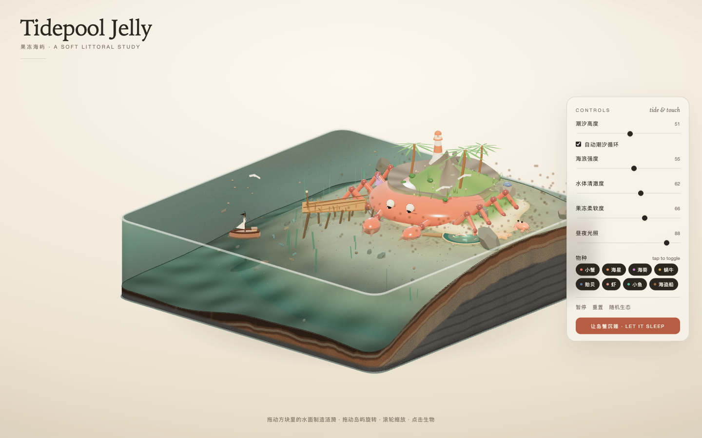

# Tidepool Jelly · 果冻海屿

A soft little tidepool island living inside a slab of jelly — a single-file Three.js diorama.



## What it is

A cross-section of a tidepool cut out of a warm, translucent slab: water, sand, soil strata, palms, a lighthouse, a wooden pier, and a handful of small creatures. The island itself sits on the back of a sleeping island crab.

- **One file.** `index.html` is the whole project — no build step, no bundler, no image or model assets.
- **Procedural.** Every mesh, texture and material is generated in code. three.js r170 is loaded from a CDN via an import map.
- **Alive.** A height-field water simulation you can drag to make ripples, a day/night cycle, fish that school, birds overhead and fireflies after dark.
- **Wake the island.** Press *唤醒岛蟹 · wake the island* and the crab stands up, carries the mountain away on its back, muddies the water and breaks the pier. Press again to let it sleep and watch the water slowly clear.

## Run

Open `index.html` in a browser, or serve it locally:

```bash
python3 -m http.server 8000
# then open http://localhost:8000
```

An internet connection is required for the three.js CDN. Desktop-first; there is a compact mobile layout.

## Controls

| Action | How |
| --- | --- |
| Make ripples | Drag across the water |
| Rotate / zoom | Drag the island / scroll |
| Read a creature | Click it |
| Tide, waves, clarity, jelly softness, day/night | Right-hand panel |
| Toggle species | Pills in the right-hand panel |
| Pause / reset / random ecosystem | Buttons in the right-hand panel |

## Screenshots

 

 

## Tech

- three.js r170 (ES modules, import map, jsDelivr CDN)
- custom water height-field simulation, jelly-style vertex wobble, procedural soil strata, day/night lighting, particles
- no dependencies to install, no build

## 中文

一池果冻里的潮间带小岛：剖面玻璃方块里装着海水、沙地、土层、棕榈、灯塔、木栈桥和一群会动的小生物，整座岛坐在一只沉睡的岛蟹背上。

直接打开 `index.html` 即可。支持拖水面起涟漪、拖岛屿旋转、滚轮缩放、点生物看卡片；右侧面板可调潮汐、海浪、清澈度、果冻柔软度、昼夜光照，还能一键唤醒岛蟹——它会站起来把山背走、搅浑海水、撞散栈桥。

## License

[MIT](LICENSE)
